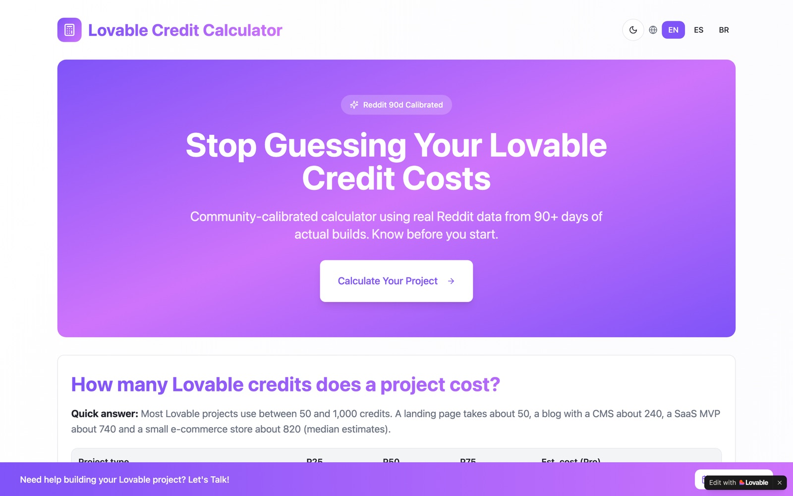
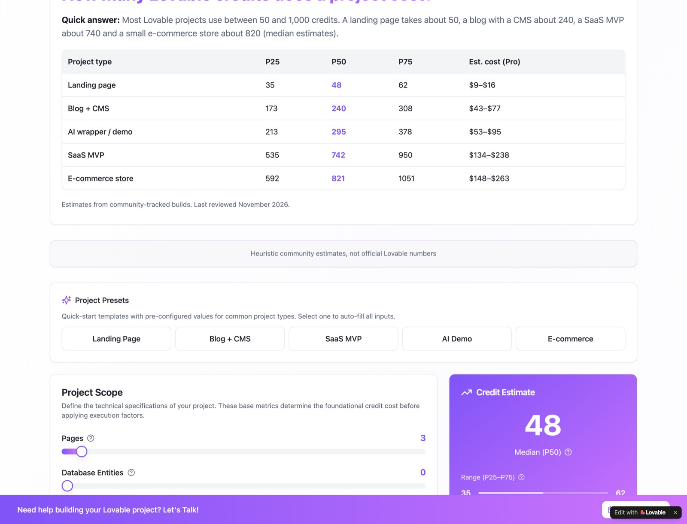
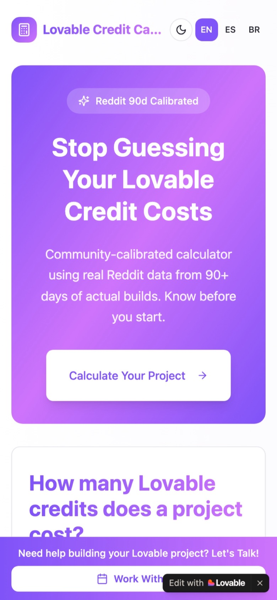

# Lovable Credit Calculator: a case study

**Live:** [app-calculator.lovable.app](https://app-calculator.lovable.app/)

A free tool I built for fun that estimates how many Lovable credits an app will take before you start building it. It got organic Google traffic with no domain, no sitemap and no Search Console. Then someone copied it and outranked it. This repo tells that story and shows how the tool works. The source code stays private.

## The problem

Lovable charges in credits, and every builder asks the same question before starting: *how many credits will my app need, and which plan do I buy?* The official docs give per-prompt examples, but nothing tells you what a whole project costs. On Reddit, people kept reporting very different numbers for similar builds.

## What I built

- **A credit estimate with a range.** You describe the project (pages, database tables, login, integrations, AI features, languages) and get a low (P25), likely (P50) and high (P75) credit estimate.
- **Execution factors**, because the same app costs more when it is built by a beginner, polished to pixel-perfect, or fought through a buggy session. Design polish, experience, tool bugginess, iteration rounds and the share of re-generated steps all adjust the estimate.
- **A community-calibrated model.** Besides a conservative baseline, a "Reddit 90d" profile is calibrated on credit numbers that builders reported on r/lovable over 90 days.
- **Presets** for common projects (landing page, blog with CMS, SaaS MVP, AI demo, online store), a budget in dollars, a cost breakdown, and an export of the summary.
- **Three languages:** English, Spanish and Brazilian Portuguese.

| Project (median estimate) | Credits |
|---|---|
| Landing page | about 50 |
| Blog with a CMS | about 240 |
| SaaS MVP | about 740 |
| Small online store | about 820 |

## What happened

1. **October 2025:** I built it in [Lovable](https://lovable.dev) and published it on a free `lovable.app` address. The only promotion was one Reddit thread with the link.
2. **No setup, still traffic.** No custom domain, sitemap or Search Console, yet organic visitors kept arriving. Pages on `lovable.app` can rank quickly: the whole domain gets about 237,000 organic visits a month (Ahrefs, October 2026), and a small tool that answers one exact question has little competition.
3. **Then a copy appeared** on another `lovable.app` address, with my text and calculation model reproduced word for word and ads added. It went to the top of Google for "lovable credit calculator", one place above the original.
4. **November 2026:** I filed copyright notices with Lovable, Google and Bing, and started improving the original (a quick-answer table, structured FAQ data, updated pricing). The outcome will be added here.

## What I took from it

- **Answer one exact question.** "How many Lovable credits do I need?" beat broad pages because nothing else answered it directly.
- **A free subdomain is a fine launch pad, not a home.** It ranks fast, but anyone can launch the same page next door. Own the domain once a page shows traction.
- **Make the page readable without JavaScript.** Single-page apps show Google one empty shell; each page needs its own title, description and text in the HTML.
- **Keep dated proof of your work.** A private repo with dated commits made the copyright case easy to document.

## How it is built

- [Lovable](https://lovable.dev) (React, TypeScript, Vite, Tailwind, shadcn/ui), synced to a private GitHub repo.
- Pure client-side calculation, no backend needed.
- Next: a set of price guides and a cost comparison across AI coding tools (Lovable, Bolt.new, v0, Replit, Cursor, Claude Code), folded into the same site.

## About

Built by [Gabriel Mangabeira](https://mangabeira.net). This is an unofficial community tool, not affiliated with or endorsed by Lovable.

---

© 2025-2026 Gabriel Mangabeira. All rights reserved. The text, images and calculation model described here may not be copied or republished without permission.
